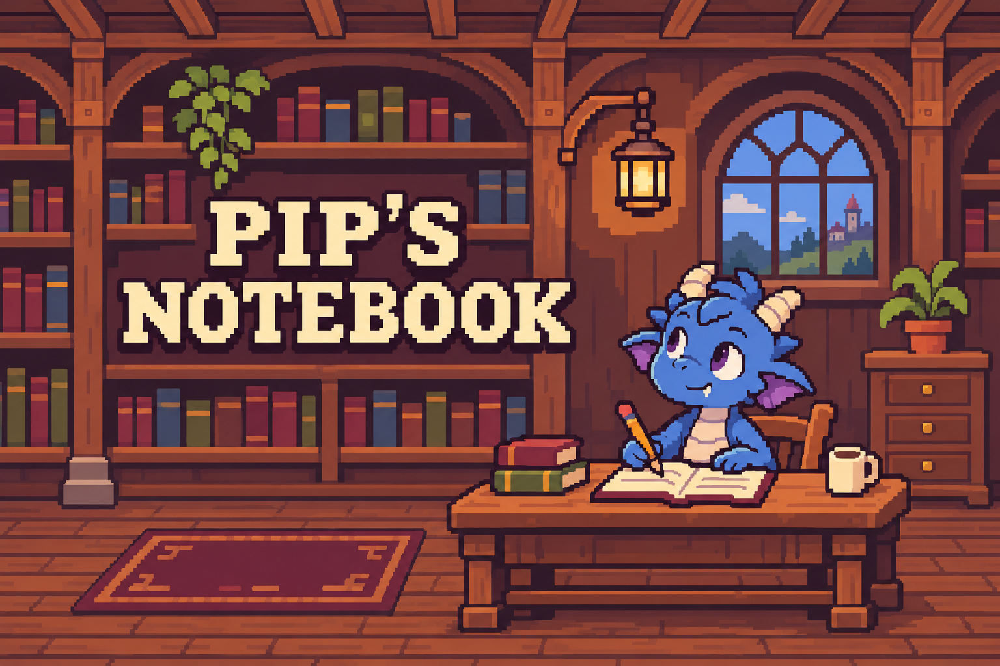

# Pip's Notebook

A turn-based dungeon game where you can't fight. You can only teach.

Upload your course material, teach Pip what's in it, then send Pip into the dungeon. Pip writes down what you explain and asks questions when something is unclear. In battle, Pip answers using **only that notebook**: never your material and never the answer key. Whatever you left out or taught wrong shows up in the fight.

The final boss is an exam on the rooms you chose. The results show a predicted grade and the parts of your material to revisit. The grade is a game estimate, not a prediction of a real exam score.



**This is the public edition.** It runs entirely in your browser, with no server: the game, preparing dungeons from your uploads, Pip's AI turns, grading and search over your material. Your dungeons are saved in your browser. Bring your own Gemini or OpenAI key, or play the sample lessons Offline with no key at all.

## Play it

Open the game's website, press **Play** and pick a sample lesson (**Gravity** is the quickest). That's all: no account, no install, no key. Without a key the game runs in **Offline** mode, which uses simple built-in rules instead of AI: Pip learns a fact when your explanation uses its key words, so explain each idea in plain sentences.

To learn from **your own material**, open **Settings**, choose **Google Gemini** or **OpenAI**, paste your API key and press **Save & apply**:

- The key is saved **only in your browser** and sent **only to the provider you chose**, straight from the page. There is no server in between, and the key is never part of the site.
- Usage is billed to your own API account. Gemini keys come from [Google AI Studio](https://aistudio.google.com/apikey), OpenAI keys from [platform.openai.com](https://platform.openai.com/api-keys).
- On a shared computer, untick **Remember my key on this device**: the key is then forgotten when the tab closes.

**Your dungeons, notebooks and expeditions** are saved in this browser (IndexedDB) and survive reloads and restarts. They stay on your device: clearing the site's data or closing a private window deletes them. **Settings → Saved in this browser** shows what is saved, asks the browser to keep it, and has **Download backup** and **Import backup** to keep a copy or move it to another browser. A backup never contains your API key.

Keep the tab open while a new dungeon is being prepared: the preparation runs in the page, and the browser asks before you close it.

### On your own computer

1. Install **Node.js 22 or later** (the LTS from [nodejs.org](https://nodejs.org) works). It includes npm.
2. Get this repository: `git clone` it, or use **Code → Download ZIP** on GitHub and unzip it.
3. Start it: double-click `start.command` (macOS) or `start.bat` (Windows), or run this from the repository folder:

   ```sh
   npm start
   ```

The first start downloads the build tools (about a minute). `npm start` builds the site into `site/` and serves it at [localhost:8787](http://localhost:8787), then opens your browser. It is only a file server, like a web host: the game itself runs in the browser. Press **Ctrl+C** to stop. Another port: `npm start -- --port 9000`.

## Put it on the web

`npm run build` writes `site/`, a folder of plain files (about 32 MB, mostly music and pictures). Any static web host can serve it, at a domain's root or under a path. [docs/HOSTING.md](docs/HOSTING.md) walks through it, including pointing a GoDaddy domain at it:

| Option | Cost | How it updates |
|---|---|---|
| **GitHub Pages** with the included workflow (`.github/workflows/pages.yml`) | Free (public repository) | Every push to the `public` branch rebuilds and publishes the site. |
| **Cloudflare Pages** or **Netlify**, connected to the repository | Free | They run `npm run build` on every push and serve `site/`. |
| A shared hosting plan (GoDaddy, cPanel and similar) | The plan's price | Run `npm run build` and upload the contents of `site/` to `public_html`. |

Every option needs **https** (all three give it for free): browsers allow the microphone for dictation only on secure pages.

## How a game works

| In the game | What it means |
|---|---|
| **Dungeon** | A course prepared from your material: PDF, Markdown or plain-text files and pasted notes, up to 25 MB and 300 pages. Create one under **My archive → Create New Dungeon**. |
| **Room** | One lesson in the dungeon, with a description and teaching goals. With an AI provider, a lecture usually becomes 3–5 rooms (1–2 for short material, never more than 6). |
| **Topic** | One idea inside a room. You teach a room topic by topic. |
| **Notebook** | What Pip wrote down from your teaching. It is Pip's only source in battle. |
| **Wrong belief** | A common misconception about a topic. If you teach it, or skip Pip's question about it, it goes into the notebook looking like any other note. |
| **Expedition** | One playthrough of a dungeon, from the first room to the results. Expeditions are saved in **My archive**, where you can resume, end or remove them. |
| **"Help me!"** | Now and then Pip asks you to answer a question yourself, with a timer based on how hard it is. |

A room has two halves. In the **lesson**, open **Talk to Pip**, explain each topic and answer Pip's questions; **Pip has a question!** means one is waiting. Once Pip has notes on a topic, a **Topic taught** banner appears with a button to the next topic; you can still teach that topic more. Then press **Ready: go fight** and use **Next turn** to watch Pip answer from the notebook. Each turn shows Pip's answer, reasoning, the notes Pip used and the correct answer. If Pip runs out of hearts, **Retry** returns to the lesson with the notebook kept and hearts refilled. The boss exam covers every room in the expedition, and up to half of its questions aim at wrong beliefs still in the notebook.

Other things in the game:

- **Rooms** and **Pause** open the expedition menu without losing your place, and pausing stops "Help me!" timers.
- **Dictate** turns speech into text using your browser's speech recognition. If the browser can do it on your device (recent Chrome with the language downloaded), the audio stays there. Otherwise Chrome, Edge and Safari send your voice to Google, Microsoft or Apple to turn it into text; the Dictate button, the listening message and Settings say so. Browsers without speech recognition, such as Firefox, download an open speech model once (Moonshine base, about 63 MB, from jsDelivr and Hugging Face) and run it in the page, so the audio stays on your device.
- While a dungeon is being prepared, **Thinking** shows progress and, with OpenAI, the model's public reasoning summary (not its private reasoning). You can start an expedition as soon as its first room is ready.
- **Offline** mode replays canned AI responses for the sample lessons. Uploads in Offline mode use a simple heuristic and often fail to prepare: choose a provider for your own material.
- Music changes with each scene. The **Music** button turns it off, and your browser remembers the choice.

## How it's built

There is no backend. The page loads two bundles: `game.js`, the Phaser AE game, and `backend.js`, the game logic that the original edition ran on a Node server. The game talks to `backend.js` through the same API client and routes as before, but the requests are answered inside the page and never reach a network. The only requests that leave the browser go to the site's own static files and, with a key, to the AI provider you chose.

| Path | What it is |
|---|---|
| `client/` | The game. Source in `client/game/` (screens in `client/game/course/`), prebuilt copy in `client/dist/`. |
| `server/` | The game logic, run in the browser: API routes (`router.ts`), game rules (`engine/`), course preparation (`ingest/`), search over your material (`rag/`), AI providers (`llm/`), and storage in IndexedDB (`repo/indexeddb.ts`). `browser/main.ts` is the entry point bundled as `backend.js`. The name is kept from the server edition. |
| `shared/` | The data contracts (Zod schemas) every request is checked against, and the API client the game and scripts use. |
| `samples/` | Three sample handouts with ready-made dungeons (Gravity, Binary Search, Why Earth Has Seasons), plus `rock-paper-scissors.pdf` for trying an upload. |
| `scripts/` | `build.mjs` (the static site), `start.mjs` and `serve.mjs` (what `npm start` runs), the end-to-end test and the API doc generator. |
| `docs/` | Hosting, architecture, API reference, run phases, course preparation, rules and decisions, and marketing art. |

See [docs/ARCHITECTURE.md](docs/ARCHITECTURE.md) for details.

**What the browser can see.** Everything runs on the player's device, so a curious player can read a dungeon's answer keys in the browser's developer tools. The game itself never shows them before a question is answered, and the API's public responses are tested to contain no hidden fields.

## Commands

Run these from the repository folder after `npm ci` (`npm start` installs by itself).

| Command | What it does |
|---|---|
| `npm start` | Builds the site and serves it on localhost, then opens the browser. |
| `npm run build` | Writes the deployable static site to `site/`. `-- --out <folder>` writes it elsewhere. |
| `npm test` | Runs the tests, including the static site and a check that `client/dist/` is up to date with the game source. `npm run test:watch` reruns on changes. |
| `npm run typecheck` | Type-checks `server/` and `shared/`. The game's own check is `npm --prefix client run typecheck`, which needs the Phaser tools. |
| `npm run e2e` | Plays a full game against the backend in Node (Offline, in memory) and prints the transcript. Add `-- --sample binary-search` for another sample. |
| `npm run build:game` | Rebuilds `client/dist/` from the game source. Needs the Phaser tools (below). |
| `npm run ingest -- <file>` | Prepares a dungeon from a file and saves it to `samples/cache/`, which adds it to the built-in samples. Uses the provider from the environment, for example `GEMINI_API_KEY=… npm run ingest -- notes.md`. |
| `npm run llm:smoke` | Makes one live call for each in-game AI task plus one embedding, with the key from the environment. Skipped without one. |
| `npm run docs:api` | Rebuilds `docs/API.md` from recorded requests. `npm run e2e -- --capture-file docs/api-examples.json` records new ones. |

## Demo script

1. Open the game ([Play it](#play-it)).
2. Press **Play** and pick a lesson from the Library: **Gravity** for a short game (one room with two topics, a three-question room fight with a "Help me!" on the second question, and a four-question boss), or **Why Earth Has Seasons** for a full one. Choose a target grade and start.
3. **Lesson.** Open **Talk to Pip**, explain each topic and answer Pip's questions. Check the notebook before pressing **Ready: go fight**. To see a wrong belief at work, teach one on purpose, for example "There is no gravity in space."
4. **Room fight.** Press **Next turn** and watch Pip answer from the notebook. Click a turn to see Pip's answer, the notes Pip cited and how it was graded.
5. **"Help me!"** When Pip asks for help, answer before the timer runs out.
6. **Boss.** The exam covers every room you chose and goes after wrong beliefs left in the notebook.
7. **Results.** See the predicted grade, whether you met your target, and each wrong belief that cost points, with the page and section of your material that explains it.

## Changing the game

The site uses the prebuilt game in `client/dist/`. Changing game code means rebuilding it, which needs the Phaser AE tools. Install them once from the `client/` folder; the setup asks you to sign in with your own Phaser account:

```sh
cd client
npx -y @phaser-ae/cli@0.8.0 setup
npx -y @phaser-ae/cli@0.8.0 update
node restore-packs.mjs
npm run build
```

`update` may warn that the game did not build; the next two commands fix that. Afterwards, `npm run build:game` rebuilds from the repository folder. Commit `client/dist/` together with your code change: `npm test` fails when the prebuilt copy is older than the source. The game starts in `client/game/main.ts`. Add `?mock=1` to the game's address for **Practice mode**, where the page answers itself with canned data. `client/AGENTS.md` lists the other Phaser AE commands.

Changes to `server/` or `shared/` need no Phaser tools: `npm run build` bundles them into `backend.js`.

## Docs

- [docs/HOSTING.md](docs/HOSTING.md): putting the site online, with a domain.
- [docs/ARCHITECTURE.md](docs/ARCHITECTURE.md): how the pieces fit, AI providers and Settings, storage in the browser, and how the game uses the API.
- [docs/API.md](docs/API.md): every endpoint of the in-page API with a real request and response.
- [docs/STATE_MACHINE.md](docs/STATE_MACHINE.md): the phases of an expedition and which action is allowed when.
- [docs/INGEST.md](docs/INGEST.md): how uploaded material becomes rooms and checked questions.
- [docs/FRONTEND_VARIABLES.md](docs/FRONTEND_VARIABLES.md): every public field, by game screen.
- [client/game/README.md](client/game/README.md): the game's source files.
- [docs/SPEC.md](docs/SPEC.md) and [docs/DECISIONS.md](docs/DECISIONS.md): the rules and the choices made along the way.

## Artwork

[3:2 thumbnail](docs/marketing/pips-notebook-thumbnail-3x2.png) · [landscape version](docs/marketing/pips-notebook-thumbnail-v2.png). The prompts used to make them are next to the images in `docs/marketing/`.

## Credits

| Library or service | Used for | License |
|---|---|---|
| [Phaser AE](https://phaser.io) | The game engine and build tools | PolyForm Shield 1.0.0, with permission to make and sell games |
| [Zod](https://zod.dev), [`zod-to-json-schema`](https://github.com/StefanTerdell/zod-to-json-schema) | Data contracts and structured AI output | MIT, ISC |
| [`@google/genai`](https://github.com/googleapis/js-genai) and the Google Gemini API | AI provider | Apache-2.0 |
| [OpenAI API](https://platform.openai.com/docs), called directly over HTTPS | AI provider | OpenAI terms |
| [`unpdf`](https://github.com/unjs/unpdf) (with pdf.js) | Reading PDF text in the browser | MIT, Apache-2.0 |
| [esbuild](https://esbuild.github.io) | Bundling `backend.js` | MIT |
| [Transformers.js](https://github.com/huggingface/transformers.js) with [Moonshine base](https://huggingface.co/onnx-community/moonshine-base-ONNX) | Dictation fallback, loaded in the browser when needed | Apache-2.0, MIT |
| [Silkscreen](https://fonts.google.com/specimen/Silkscreen) | Pixel font | SIL Open Font License (`client/game/media/OFL-Silkscreen.txt`) |
| [TypeScript](https://www.typescriptlang.org), [`tsx`](https://tsx.is), [Vitest](https://vitest.dev), [`fake-indexeddb`](https://github.com/dumbmatter/fakeIndexedDB), [`pdf-lib`](https://pdf-lib.js.org) | Language, running TypeScript, tests, IndexedDB in tests, test PDFs | Apache-2.0, MIT, MIT, Apache-2.0, MIT |
