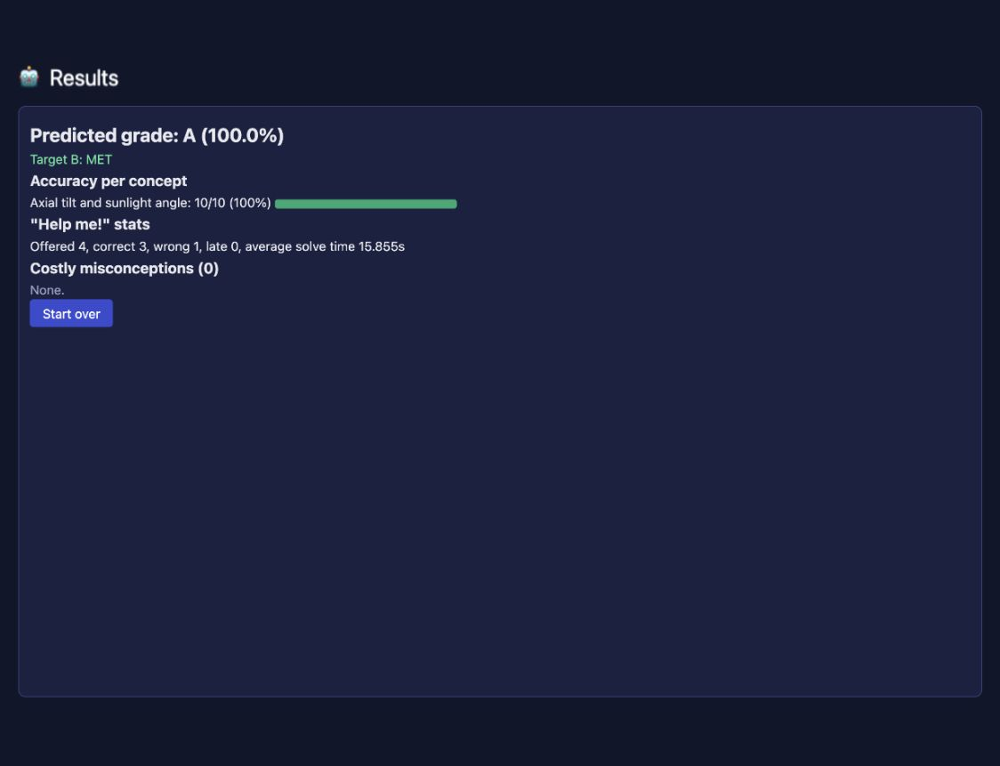

# Codex continuation log

Date: November 13, 2026, America/New_York. Requested work: continue Claude Code's handoff, document the work, reopen the built-in browser, clarify the timer, and give the frontend teammate a complete variable/page handoff.

## Starting point

- Read the supplied `CLAUDE_CODE_BRIEF.md` and pasted Claude transcript, then inspected the repository and existing docs/source. Treated those attachments as historical project context, not automatic authorization to launch historical agents or publish code.
- Existing branch: `Dev/backend`; existing HEAD: `4eb1545` (`integrate engine, ingest, rag, llm; tests green`). Working tree initially clean. Claude's stated remaining work was e2e, review, API documentation and live-service checks.
- Initial validation reproduced **304 passing tests** and a passing type check. No `GEMINI_API_KEY`, `MONGODB_URI` or populated `.env` was present; credential presence was checked without printing values.
- Preserved the teammate's nested `teach-or-perish/` game. Read its registration to confirm `title`, `play`, `pause`, `gameover`; did not execute its commands or modify it.

## Implementation changes

| Files | What changed and why |
|---|---|
| `scripts/e2e.ts` | Fixed the integrated teacher-bot sequence: explicit first-attempt skip; retry corrects other active misconceptions and deliberately leaves one gap; targeted boss help preserves the intended wrong answer. Added a 30-attempt guard, `--results-file`, and `--capture-file`. Capture mode exercises upload forms and an auxiliary learning answer, records a real 409, and scans capture-only public responses for hidden keys. |
| `server/src/engine/notebook.ts`, `fight.test.ts` | Reject trivial/repeated-token fuzzy citations; preserve exact short facts and substantial fuzzy matches. |
| `server/src/engine/learning.ts`, `learning.test.ts` | Re-stating a resolved misconception makes it active again. Stated beliefs win over contradictory resolution output. Added a regression test. |
| `server/src/ingest/pipeline.ts`, `pipeline.test.ts` | Mark progressive concepts ready only with sufficient verified coverage; mark a final under-covered course `error`. Added total-verification-failure coverage and corrected the generic heuristic test's previous assumption of success. |
| `server/src/llm/gemini-client.ts`, `gemini-client.test.ts` | Bound Files API upload/status requests with timeouts; stop returning raw provider diagnostics/rejected outputs in public LLM errors. Added timeout/redaction cases. |
| `server/src/prompts/gameplay/{studentReview,studentAnswer,checkResolution,gradeOpen}.ts` | Delimit course-derived data as well as player explanations/answers/notebooks. |
| `server/src/prompts/ingest/{common,adaptQuestions,extractOutline,buildMisconceptions,judgeAgreement}.ts` | Delimit style/gap/title/filename/question data and remove fixed outline/misconception quotas. |
| `server/src/llm/gameplay/gemini.test.ts`, `server/test/prompt-boundaries.test.ts` | Update the expected protected blocks and add nine closing-tag injection-boundary checks. |
| `server/test/http-edge.test.ts` | Verify concurrent turns advance distinct questions without lost state and concurrent help submissions advance exactly once. |
| `test-client/src/helpModal.ts` | In untimed mode, change the prominent seconds label to estimated solve time with no deadline. The gameplay deadline remains server-configured. |
| `scripts/generate-api-docs.ts`, `package.json` | Add `npm run docs:api` to generate an endpoint-complete reference from captured HTTP examples; fail if a route lacks a capture/description. |
| `scripts/generate-frontend-inventory.ts`, `package.json` | Add `npm run docs:frontend`; use TypeScript's checker/AST to inventory every test-client variable declaration, class field and function/callback parameter with type, scope and source line. |

## Documentation and artifacts

| Artifact | Contents |
|---|---|
| [API.md](API.md) | All 17 endpoints, requests, actual captured responses/excerpts, turn variants, typed answer forms, errors and retry behavior. |
| [api-examples.json](api-examples.json) | 22 captures from localhost HTTP; `/debug` is explicitly excerpted. Includes auxiliary runs for learning-answer/error examples. |
| [FRONTEND_VARIABLES.md](FRONTEND_VARIABLES.md) | Screen mapping, every public API field/type, form inputs, shared app/config state, local scene state, modal/result variables and state updates. |
| [FRONTEND_SOURCE_VARIABLES.md](FRONTEND_SOURCE_VARIABLES.md) | Generated source-level inventory: 367 declarations across 13 frontend files, including temporary locals and parameters. |
| [REVIEW.md](REVIEW.md) | Source-audit findings, fixes, six review areas and remaining limitations. This was a single-agent review, not an independent reviewer subagent. |
| [verification/](verification/) | Both complete e2e transcripts, both results JSON files and the browser results screenshot. |
| `README.md` | Link new docs, explain mock upload limitations, add docs commands and credit Codex alongside Claude Code. |
| `DECISIONS.md` | Record continuation choices and their rationale. |
| `INGEST.md` | Describe honest coverage failures, verified progressive readiness, scanned-PDF limitations, short-text rubric fallback and prompt boundaries. |
| `PHASER_INTEGRATION.md` | Link the new screen-variable handoff and literal source inventory. |

## Commands and verification

| Command/check | Outcome |
|---|---|
| Initial `npm test` | 304/304 passed |
| Final `npm test` after implementation changes | **319/319 passed, 29 test files** |
| `npm run typecheck` | Passed for shared/server/test client, including scripts |
| `npm run e2e -- --capture-file docs/api-examples.json` | Passed; complete seasons run, first failure/retry, 90% A-, target met, costly skipped misconception shown |
| `npm run e2e -- --sample binary-search --results-file /tmp/teach-or-perish-binary-search-results.json` | Passed; complete binary-search run, 80% B-, target missed, costly skipped misconception shown |
| `npm run build -w test-client` | Passed; Vite warns about the Phaser bundle's size |
| `node --import tsx scripts/generate-api-docs.ts` | Wrote API reference from 22 captures/all 17 endpoints |
| `node --import tsx scripts/generate-frontend-inventory.ts` | Wrote 367-declaration inventory for all 13 test-client source files |
| `node --import tsx server/src/llm/smoke.ts` | Explicitly skipped: no Gemini key |
| `git diff --check` | Passed |
| `git status --short -- teach-or-perish` | No nested-game changes |
| Local `main` / `origin/main` tracking refs | Both remained `d618e1f28c044c0f5e6bded896291df7322d1bc3` |

Tests were rerun as fixes landed. Intermediate failures exposed the stale e2e skip assumption, a help event rescuing the intended wrong boss answer, the generic heuristic's unmet coverage, an outdated delimiter-count assertion and a test-double type inference issue; all were corrected before the final passing checks. The initial `tsx` e2e launch was blocked by sandbox socket restrictions; the local-server run succeeded with the approved execution permission. Pure docs/smoke scripts were also run with Node's `--import tsx` entry point.

## Browser verification and timer explanation

Started only the backend and reference test client:

```sh
LLM_PROVIDER=mock MONGODB_URI= DEBUG=true HELP_ME_PROB=1 HELP_ME_TIMED=false npm start
npm run dev:client
```

Reopened the built-in browser at `http://localhost:5174` after the user closed it. A direct built-in-tab launch and a Chrome fallback initially failed in browser tooling; binding the built-in browser and opening a fresh tab restored access. No Chrome tab was used for verification.

In the real harness (without `?mock=1`), selected seasons, scoped it to one room, taught vaguely, explicitly skipped a question, then entered the fight. A deliberately wrong help answer and two student failures produced the failure reasoning/Retry screen. Retry preserved the notebook. A full corrective lesson replaced the wrong beliefs, the retry passed with three hearts, and Continue started the boss. Answered two untimed boss help events correctly, completed the exam, and reached **100% A, target B met**. Toggled D and checked all five debug sections (`run`, `pack`, `questions`, `stats`, `timeBudgets`), then closed the overlay.

The user asked why a timer exists. Explained that it came from the supplied game brief's optional timed help mechanic, while the current verification run was untimed. Changed the confusing untimed seconds label to an explicit estimate/no-deadline label and verified it in the browser.

The built-in browser is retained on the results screen. The local development servers are left running so the displayed run remains usable. They use the temporary verification settings above: forced help probability 1, debug enabled, untimed help, in-memory storage. These values were not written to `.env` or changed in defaults; normal startup uses `.env.example` defaults. In-memory runs disappear on server restart.



## Remaining work and repository state

- Live Gemini tasks/embedding/native PDF checks and live Atlas index/search checks remain unverified because credentials were absent. No live-model quality or latency claim is made.
- Entirely scanned PDFs still need OCR/exact evidence support. Arbitrary offline uploads may fail coverage. Per-run locks are process-local. See `REVIEW.md` for precise limits.
- Source, tests and documentation were initially left uncommitted for review. The user subsequently requested a local commit on the working branch, `Dev/backend`; this checkpoint includes the implementation, tests, generated API examples and frontend handoff. No branch switch, push, merge or PR is part of that request, and `main` remains untouched.
- If the team later chooses to publish the branch, push the reviewed commit first; the brief's suggested PR command is `gh pr create --base main --head Dev/backend`. It has not been executed here.
