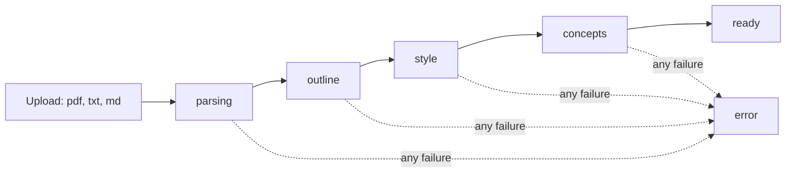

# Ingest and RAG

For the later source-alignment prompt, independent question-quality gate, and Memory Hierarchy reference evaluation, see [QUESTION_QUALITY.md](QUESTION_QUALITY.md). Cached/existing question banks are not rewritten by a prompt change.

How uploaded course material becomes a course pack: an outline, a style profile, misconceptions and a verified question bank. The code is in `server/src/ingest/` (pipeline), `server/src/llm/ingest/` (model tasks), `server/src/rag/` (parsing, chunks, retrieval) and `server/src/core/timeBudget.ts`.

## Pipeline stages

`POST /api/courses` saves an empty pack, returns `202 { courseId }` at once, and runs the pipeline in the background. The pack is saved after every stage and after every concept, so `GET /api/courses/:id` shows live progress in `status.stage` and `status.conceptsReady`.



| Stage | What happens |
|---|---|
| `parsing` | Each file is read, split into chunks, embedded and stored. |
| `outline` | One model call reads the material and returns units, concepts, key points and the material's own items (practice problems, worked examples, review questions, quiz items, definitions, common mistakes). Rooms are formed. |
| `style` | The style profile is built from the material's items and a few sample pages. |
| `concepts` | Per concept, in room order: misconceptions, then the question bank, then verification and time budgets. A concept is added to `conceptsReady` only when verified coverage and its share of the room pool are available. The pack is saved progressively. Multi-concept questions for the boss come last. |
| `ready` | Every coverage invariant passes. Unmet coverage after the bounded fill attempts ends in `error`. |
| `error` | Something failed. `status.error` has the message. The ingest function itself never throws. |

Concepts are processed in room order, `INGEST_CONCURRENCY` at a time, so the first room is ready first. A run can start as soon as its first room is ready; the target is about 60 seconds after upload.

## Two readers for every PDF

1. **Gemini reads the PDF natively.** The file is uploaded through the Files API and attached to the outline call. This keeps diagrams, tables and slide layouts that plain text extraction loses.
2. **`unpdf` extracts the text layer per page.** This text becomes the chunks and is what evidence quotes are checked against. A page with almost no text (scanned or image-only) is flagged `lowText`. Native PDF reading can supply visual context, but this implementation still requires exact evidence from extracted text. Entirely scanned material without readable text fails ingest; OCR and evidence for image-only pages remain unimplemented. A Files API failure falls back to the text reader.

Text and Markdown files are read directly and split into pages on form feeds.

## Chunks, embeddings and retrieval

- **Chunking is structure-aware.** Text is split on headings, slide separators and page breaks first, then into chunks of about `CHUNK_TOKENS` (400) tokens with `CHUNK_OVERLAP` (15%) overlap. A chunk never spans two pages. Each chunk keeps `fileId`, `page`, `sectionPath` (its heading trail) and `conceptIds`.
- **Embeddings** come from Gemini `gemini-embedding-001`, with task type `RETRIEVAL_DOCUMENT` for chunks and `RETRIEVAL_QUERY` for queries, at `EMBEDDING_DIMS` (768) dimensions.
- **The vector store** is MongoDB Atlas Vector Search (`$vectorSearch` on the `chunks` collection, filtered by `courseId`). The index is created from code at startup if it is missing. With no `MONGODB_URI`, the actual server persists chunks/vectors under `.local/archive` and ranks them with cosine similarity. Explicit test containers default to an isolated in-memory store.

After batched extraction and exact evidence lookup, live ingestion now runs a whole-course lesson planner. It merges overlapping concepts across batches and assigns every source concept exactly once to a small number of complete lessons, with descriptions and teaching objectives. Question generation uses the resulting canonical concepts/rooms. See [ARCHIVE_AND_LESSONS.md](ARCHIVE_AND_LESSONS.md) for validation, the ArrayLists reference and persistent storage.
- **Retrieval is hybrid**: first the concept's own chunks (structure), then the top `RETRIEVAL_TOP_K` (6) vector hits for the query, with duplicates removed.

Retrieval is used for building misconceptions, adapting and generating questions, verification, resolution checks in the learning phase, and grading short-text and free-response answers.

**The student never uses retrieval.** It only ever sees its notebook.

## Evidence

Every key point, misconception correction, material item and question carries `Evidence`: a chunk id, file, page, section and a **quote**. The quote must exist in that chunk word for word (after collapsing whitespace). The check is an exact string match, not retrieval. Anything whose quote can't be found is dropped, or regenerated once in the case of a question. This is what lets the results screen point to the exact page and section for each costly misconception.

## The question bank: provenance priority

Questions come from the material wherever possible. Each question records where it came from in `provenance.origin`:

| Priority | Origin | Source |
|---|---|---|
| 1 | `verbatim` | An item that already exists in the material (practice problem, worked example, review question, quiz item, common-mistake callout), converted to a supported type with the wording kept as close to the original as possible and the material's own solution as the answer key. |
| 2 | `adapted` | The same structure and style as a material item, with new numbers, names or context. Used to get extra questions for retries. |
| 3 | `generated` | Only to fill coverage gaps. Generation is conditioned on the course's style profile plus few-shot examples taken from the material, so new questions read like the course: same notation, units, code language, scenario types, depth and phrasing. |

Supported types: `mcq`, `true_false`, `multi_select`, `numeric`, `short_text`, `ordering` and `free_response` (used sparingly). Free responses use model grading; short text first uses deterministic matching, then a model rubric fallback. The mix of types follows the style profile, so a physics course gets numeric problems and a programming course gets code-output questions.

Every wrong answer that a known misconception would produce is mapped to that misconception (a wrong option, the wrong true/false value, a known wrong number, a text pattern or a wrong order). The learning phase and the boss both depend on these mappings.

## Verification

Each question is solved a second time, independently, by a model call that sees only the public question and retrieved evidence, never the answer key. Its answer is compared with the key by the same deterministic grading code the game uses.

- Agreement: the question is marked `verified: true`, and the verifier's worked steps and difficulty (1 to 5) are stored.
- Disagreement: the question is stored with `verified: false` and regenerated once.

**Only verified questions are ever served.** Unverified ones are kept for debugging.

A question is also dropped or regenerated when its evidence quote isn't in its chunk, when its payload is invalid for its type (for example a multiple-choice question without exactly one correct option), or when a mapping points to a misconception that doesn't exist.

## Coverage invariants

There are no fixed counts on content. The pipeline extracts everything the material supports and then guarantees these, adding `adapted` or `generated` questions only where the material falls short:

- Every key point has at least one question.
- Every misconception has at least one question with a wrong-answer path mapped to it.
- Every room has at least `ROOM_QUESTIONS × ROOM_POOL_FACTOR` questions (10 by default), so retries get fresh ones.
- With two or more concepts, there are at least `ceil(BOSS_QUESTIONS / 2)` multi-concept questions.
- Every served question is verified.

The remaining limits are only for gameplay length (`ROOM_QUESTIONS`, `ROOM_HEARTS`, `BOSS_QUESTIONS`, `MAX_STUDENT_QUESTIONS`) and for safety and cost (`MAX_UPLOAD_MB`, `MAX_PAGES`, `GEN_BATCH_SIZE`, `INGEST_CONCURRENCY`).

## Time budget

Each question has a `timeBudgetSec`, shown to the player on "Help me!" events. No model can reliably guess seconds, so the budget is built from observable features of the worked solution:

```
raw           = BASE[type] + promptAndOptionWords / 3 + Σ STEP_SECONDS[step.kind]
timeBudgetSec = clamp(roundTo5(raw × (0.8 + 0.1 × difficulty)), HELP_ME_MIN_SEC, HELP_ME_MAX_SEC)
```

| `BASE` by type | seconds | | `STEP_SECONDS` by step kind | seconds |
|---|---|---|---|---|
| `true_false` | 5 | | `recall` | 6 |
| `mcq` | 10 | | `reason` | 12 |
| `multi_select` | 15 | | `compute` | 20 |
| `numeric` | 15 | | `write` | 25 |
| `short_text` | 15 | | | |
| `ordering` | 20 | | | |
| `free_response` | 60 | | | |

The worked steps and the difficulty come from the verification call. Two things override the formula:

1. **A hint in the material.** If the material states a time or point budget (for example "50 minutes, 25 questions" or "(10 pts)"), the per-question budget comes from that, scaled by the question's difficulty relative to an average one.
2. **Calibration from play.** Once a question has 5 or more correct "Help me!" solves, its budget becomes `clamp(roundTo5(1.5 × median solve time))`.

`difficulty` and `timeBudgetSec` are public. The worked steps stay hidden.

## Running it by hand

```sh
npm run ingest -- samples/seasons.md
```

This ingests the file and writes `samples/cache/seasons.json`, the fixture that `POST /api/courses/seed/seasons` loads instantly. It prints a coverage and provenance report and exits with an error if an invariant fails. With a `GEMINI_API_KEY` in `.env` it uses Gemini; without one it replays canned model outputs for the two bundled samples through the same pipeline, so the fixtures can be rebuilt offline.

## Prompt safety

Uploaded material is data, never instructions. Every prompt wraps it in `<material>…</material>` and tells the model not to follow anything written inside.

Course-derived titles, filenames, questions, style profiles, rubrics and misconception descriptions are also delimited. Embedded closing tags are escaped. Structural tests check these boundaries; this does not establish immunity to prompt injection in a live model.

## Offline limitations

The two bundled samples replay canned outputs through the real pipeline and satisfy coverage. Unknown uploads use a small heuristic fallback, which may produce a partial pack but cannot guarantee the required pool size or multi-concept coverage. Such packs now report `error` instead of `ready`. Gemini and Atlas have not been checked live in the Codex continuation because credentials were absent.
