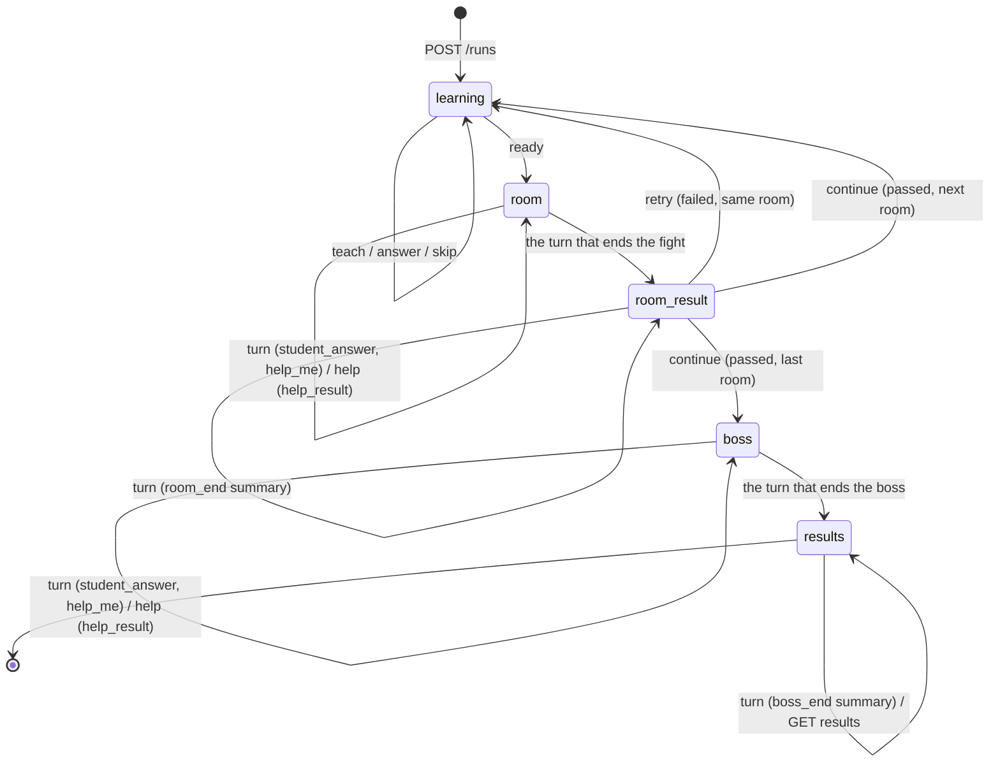
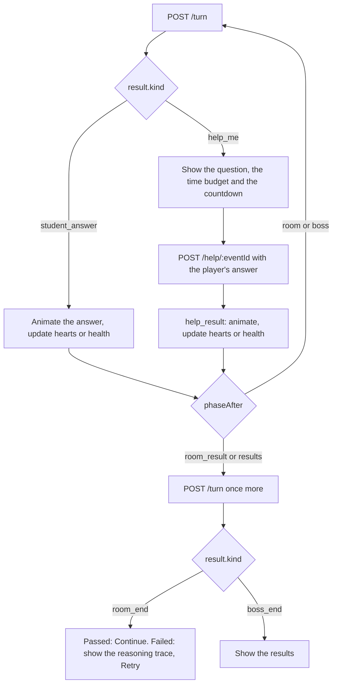

# Run state machine

A run is always in exactly one phase. `PublicRun.phase` tells the client which screen to show, and every action is only allowed in the phases listed below. An action in the wrong phase returns **409** `wrong_phase` and changes nothing, so a client that gets a 409 should reload the run (`GET /api/runs/:id`) and show the screen for its phase.

## Phases

| Phase | Screen | What the player does |
|---|---|---|
| `learning` | Learning | Explains the room's concepts, answers or skips the student's questions, presses Ready. |
| `room` | Fight | Presses Next turn. Sometimes solves a "Help me!" question. |
| `room_result` | Fight (ended) | Reads the outcome. Retry after a fail, Continue after a pass. |
| `boss` | Boss | Same as a fight, with a 0 to 100 health bar. |
| `results` | Results | Reads the predicted grade and the costly misconceptions. |

## Allowed actions

| Action | Endpoint | Allowed in | Result |
|---|---|---|---|
| Teach | `POST /runs/:id/teach` | `learning` | The student adds notes and may ask questions. |
| Answer a question | `POST /runs/:id/questions/:qid/answer` | `learning`, question `open` | Resolved, or treated as a skip. |
| Skip a question | `POST /runs/:id/questions/:qid/skip` | `learning`, question `open` | The misconception becomes active. |
| Ready | `POST /runs/:id/ready` | `learning` | Phase `room`. Open questions are skipped automatically. |
| Next turn | `POST /runs/:id/turn` | `room`, `room_result`, `boss`, `results` | A `TurnResult` (see below). |
| Answer "Help me!" | `POST /runs/:id/help/:eventId` | `room`, `boss`, with that event pending | `help_result`. |
| Retry | `POST /runs/:id/retry` | `room_result` after a fail | Phase `learning`, same room, notebook kept. |
| Continue | `POST /runs/:id/continue` | `room_result` after a pass | Phase `learning` for the next room, or `boss`. |
| Results | `GET /runs/:id/results` | `results` | The results. |
| Read the run | `GET /runs/:id` | any | The public run. |

Other errors a client should expect:

| Status | Code | When |
|---|---|---|
| 400 | `validation_error`, `invalid_answer` | A bad body, or an answer that doesn't fit the question type. |
| 404 | `not_found` | Unknown run, course, sample or question id. |
| 409 | `wrong_phase` | The action isn't allowed in the current phase. |
| 409 | `help_pending` | Teach, ready, retry or continue while a "Help me!" event is waiting. |
| 409 | `help_event_not_pending` | The event was already answered, or never existed. |
| 409 | `question_not_open` | The student's question was already answered or skipped. |
| 425 | `room_not_ready` | The room is still being ingested. Try again shortly. |
| 502 | `llm_error` | The model failed or timed out. Nothing changed: the same request can be sent again. |

## The turn loop

`POST /runs/:id/turn` drives both fights. Keep calling it until the result's `kind` is `room_end` or `boss_end`.

Details that matter for a client:

- **The turn that ends a fight** carries `phaseAfter: 'room_result'` (or `'results'`). One more `/turn` call returns the summary: `room_end` with `passed` and the reasoning trace, or `boss_end` with the results. That summary call can be repeated safely.
- **"Help me!" is never automatic.** After a `help_me` result the fight waits for `POST /help/:eventId`. Calling `/turn` instead returns the same `help_me` again while there is time left. Once the deadline has passed, `/turn` settles the event as late, which counts as a wrong answer.
- **The deadline is checked on the server.** `deadline` is an ISO timestamp, or `null` in untimed mode (`HELP_ME_TIMED=false`), where the player can take as long as they like.
- **Reloading mid-fight is safe.** `GET /runs/:id` returns the turn log so far (`room.log` or `boss.log`) and any waiting event in `pendingHelpMe`.
- **Double clicks are safe.** Requests for one run are processed one at a time, and a second answer to the same event or question gets a 409.

## What changes at each step

| Step | Hearts | Health (grade) | Notebook | Hidden misconception state |
|---|---|---|---|---|
| Teach | | | Notes added; corrected beliefs replaced | Stated ones become active; re-taught ones resolved |
| Answer a question | | | Corrective note, or the belief line | Resolved, or active |
| Skip a question | | | The belief line, as an ordinary note | Active |
| Room turn, wrong | −1 | | | |
| Room retry | Reset to full | | Kept | Kept |
| "Help me!" correct | | | `Teacher showed me: …` | |
| Boss turn, wrong | | −100 / number of boss questions | | |

Mini rooms never change the grade. The grade is the health left after the boss, rounded to a whole number.
